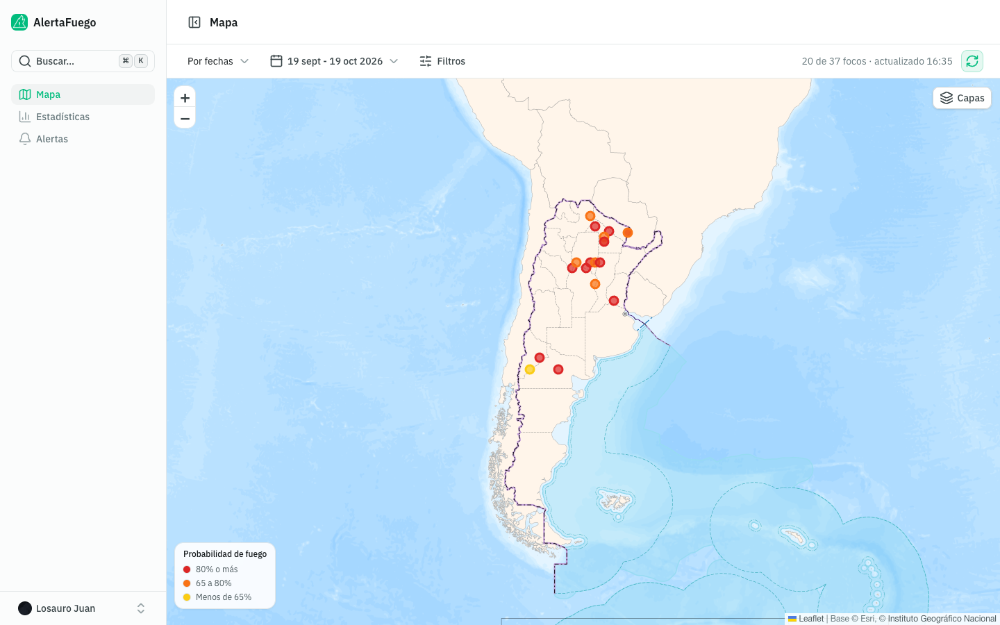
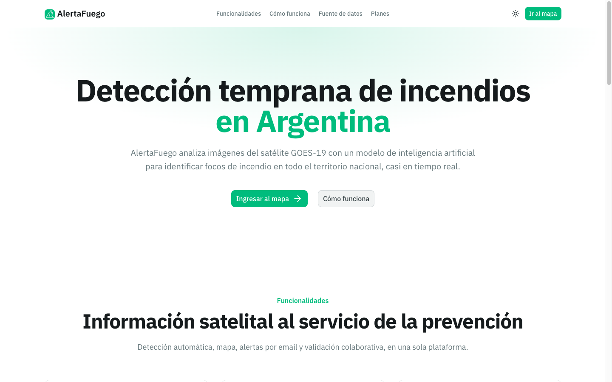

<p align="center">
  <picture>
    <source media="(prefers-color-scheme: dark)" srcset="assets/logo-dark.png">
    
  </picture>
</p>

---

[](https://alertafuego.com.ar)


<p align="center">
  
</p>

<sub>*Focos detectados sobre el mapa de Argentina, coloreados según la probabilidad de fuego que les asigna el sistema.*</sub>

# Qué es AlertaFuego

AlertaFuego es un sistema de monitoreo y alerta temprana de incendios forestales para toda la Argentina. Cada 10 minutos analiza la imagen más reciente del satélite geoestacionario GOES-19 con dos modelos de segmentación TinyUNet, entrenados con las detecciones de fuego activo del sensor VIIRS como referencia. Publica los focos en un mapa web y avisa por correo electrónico o Telegram cuando aparece uno en las zonas de alerta que definió cada usuario.

Es el Proyecto Final de Ingeniería en Informática de la Universidad Argentina de la Empresa (UADE), 2026. El sistema está en funcionamiento en [alertafuego.com.ar](https://alertafuego.com.ar).

# Cómo funciona

1. Google Earth Engine publica cada imagen de GOES-19, con una demora mediana de 17 minutos desde su captura.
2. Una función de AWS Lambda, invocada cada 10 minutos por EventBridge Scheduler, descarga la imagen más reciente sobre Argentina.
3. Los dos modelos corren en CPU sobre la imagen completa; un píxel es una detección si cualquiera de los dos lo marca, y se descartan las que caen fuera del territorio.
4. Las detecciones se guardan en PostgreSQL con PostGIS (Supabase).
5. Los usuarios con una zona de alerta que contiene un foco reciben un aviso por correo electrónico (Amazon SES) o Telegram.
6. La aplicación web, en Nuxt, se sirve como sitio estático desde S3 y CloudFront y consulta la API, que corre en otra función Lambda.

# Estructura del repositorio

- [`backend/`](backend): API en FastAPI, detección programada y alertas (`backend/`); modelo en `model/`: preparación del *dataset*, entrenamiento, inferencia y evaluación; migraciones con Alembic; pruebas con pytest; infraestructura en Terraform.
- [`frontend/`](frontend): aplicación web en Nuxt 4 con Nuxt UI; pruebas con Vitest y Playwright; infraestructura en Terraform.
- [`assets/`](assets): imágenes de este README.

# Cómo correrlo

Requisitos: Python 3.12, Node 22, un proyecto de Google Cloud con Google Earth Engine habilitado y un proyecto de Supabase con PostGIS.

```bash
# Backend (http://localhost:8000, documentación en /docs)
cd backend
python -m venv .venv && source .venv/bin/activate
pip install -r requirements.txt     # sin GPU NVIDIA: requirements-lambda.txt
cp .env.example .env                # completar
alembic upgrade head
python -m uvicorn backend.app.main:app --reload

# Frontend (http://localhost:3000), en otra terminal desde la raíz del repositorio
cd frontend
cp .env.example .env                # completar
npm ci
npm run dev
```

Los pasos completos, incluida la carga de los límites de provincias y departamentos y la ubicación de los modelos para detectar en local, están en [`backend/README.md`](backend/README.md) y [`frontend/README.md`](frontend/README.md).

# Pruebas

```bash
(cd backend && pip install -r requirements-dev.txt && pytest --cov)
(cd frontend && npm run test && npm run test:e2e)
```

Las pruebas de la API del *backend* usan una base PostGIS de prueba (`TEST_DATABASE_URL`). Los *workflows* de `backend/.github/workflows` y `frontend/.github/workflows` se incluyen como referencia del proceso de integración y despliegue continuos: se ejecutan en los repositorios de desarrollo, no en este.

# Modelo

- Los pesos de los dos modelos del sistema, b-shift y d-noleak, están en [`backend/model/checkpoints/`](backend/model/checkpoints), con sus métricas y curvas de entrenamiento.
- El *dataset* de entrenamiento no se incluye. Se construye desde Earth Engine con `python -m model.scripts.export_dataset` (un mes por carpeta) y `python -m model.scripts.merge_datasets`.
- Se entrena con `python -m model.scripts.train_model --epochs 30`, preferentemente en una GPU con CUDA.
- El detalle está en las secciones de *dataset* y entrenamiento de [`backend/README.md`](backend/README.md#cómo-construir-el-dataset).

# API

Al correr el *backend*, la API documenta sus endpoints en `/docs`. La lista, agrupada por recurso y con el tipo de autenticación de cada uno, está en [`backend/README.md`](backend/README.md#endpoints).

<p align="center">
  
</p>

# Créditos

- Juan Andrés Losauro ([@Talkird](https://github.com/Talkird)) y Tomás Ignacio Peña ([@TavishX](https://github.com/TavishX)), autores.
- Santiago Martín, tutor del proyecto.
- Universidad Argentina de la Empresa (UADE), carrera de Ingeniería en Informática.
- Datos: imágenes de GOES-19 (NOAA) y detecciones de VIIRS (NASA y NOAA), obtenidas a través de Google Earth Engine; límites de provincias y departamentos del Instituto Geográfico Nacional; mapa base de Esri y del Instituto Geográfico Nacional.

# Legal

El código se publica para su evaluación académica, sin licencia de uso: todos los derechos reservados.

AlertaFuego es un prototipo académico. Sus detecciones son orientativas y no reemplazan los avisos oficiales del Servicio Nacional de Manejo del Fuego ni las llamadas a los servicios de emergencia.

Las marcas y los datos de terceros mencionados pertenecen a sus titulares.
